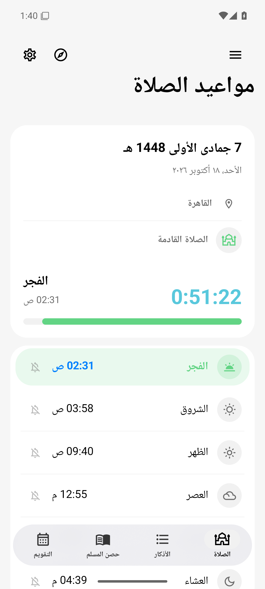
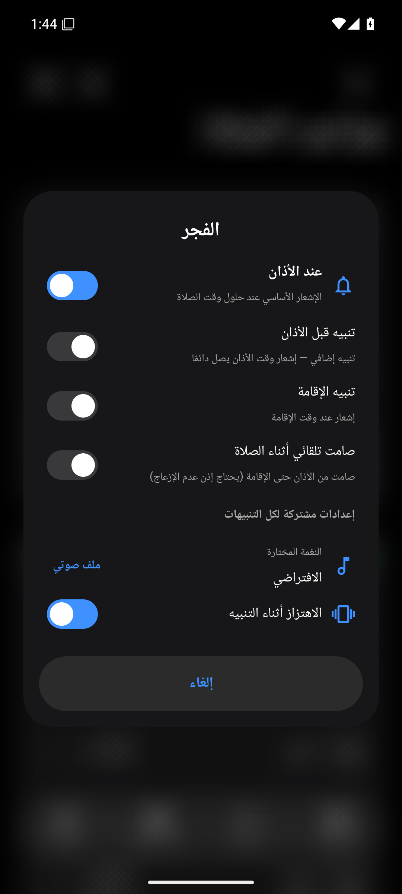
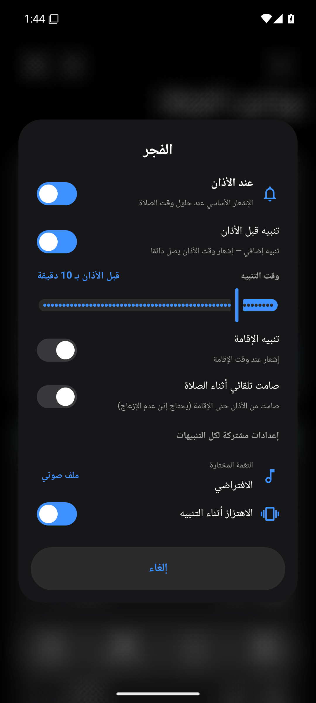
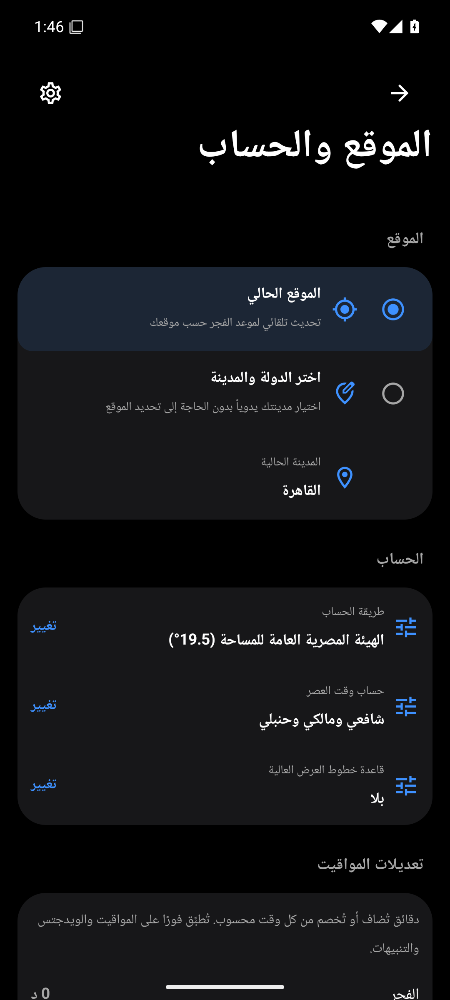
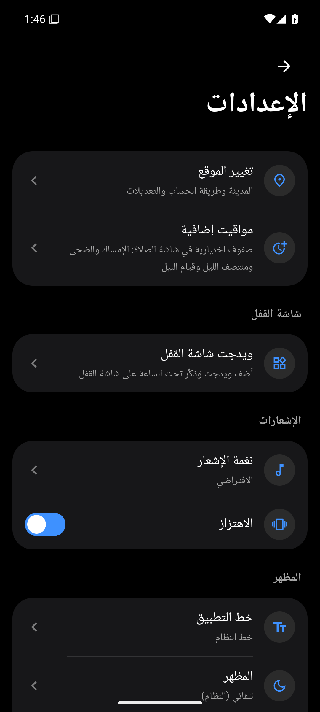
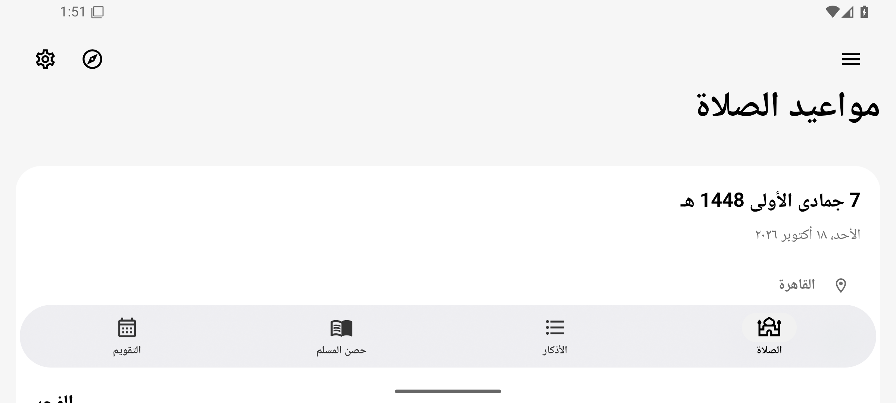
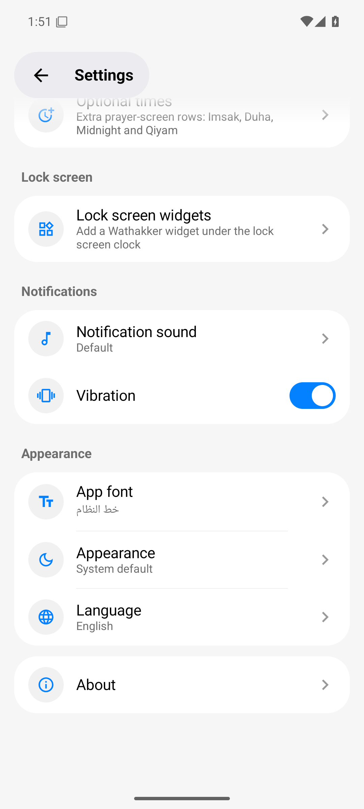
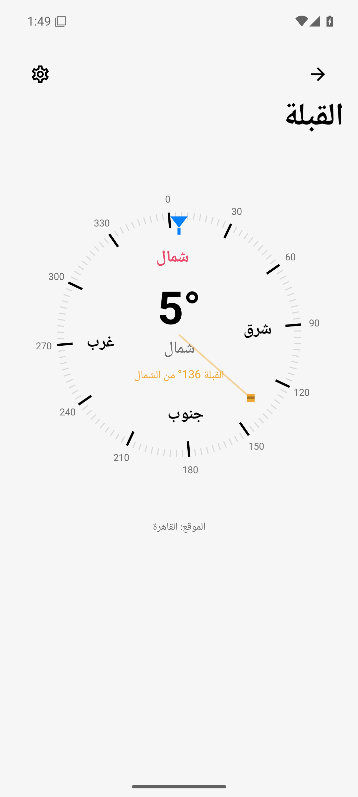

<div align="center">
  
  <h1>Wathakker (وذكر)</h1>
  <p><b>An app that reminds you of prayer times and dhikr through your day and your night.</b></p>
  <p>Accurate prayer times for your location, per-prayer adhan and iqama alerts, a Qibla compass, a Hijri date converter, and an azkar library with statistics that track your daily commitment — in a modern One UI-inspired design.</p>

  <p>
    <a href="https://github.com/MohamedElnaggar00/Wathakker/actions/workflows/build-apk.yml"></a>
    
    
    
    
  </p>

  <p><b><a href="README.md">🇪🇬 النسخة العربية</a></b></p>
</div>

---

## 📑 Contents

- [Overview](#-overview)
- [Key features](#-key-features)
- [What's new in 3.1.0](#-whats-new-in-310)
- [Screenshots](#-screenshots)
- [Supported languages](#-supported-languages)
- [Tech stack](#-tech-stack)
- [Build from source](#-build-from-source)
- [Download](#-download)

---

## 🌙 Overview

Wathakker is an open-source Android app that brings the everyday tools a Muslim needs into one place: astronomically accurate prayer times, fully customizable per-prayer alerts, morning and evening azkar with Hisn al-Muslim, a digital tasbeeh counter, and a Qibla compass — all with full right-to-left support and an interface translated into eleven languages.

## ✨ Key features

| Area | Features |
|---|---|
| 🕌 **Prayer times** | Automatic location via GPS or manual country/city selection, eight certified calculation methods (Egyptian General Authority, Umm al-Qura, Muslim World League, ISNA, University of Karachi, Kuwait, Qatar, Dubai), Asr juristic choice (Shafi'i or Hanafi), high-latitude rules, and manual per-prayer minute adjustments plus a Hijri date offset. |
| 🔔 **Prayer alerts** | An independent bell for each of the six prayer rows (including Shuruq), delivered as notifications, one-minute timing resolution (at adhan time or any number of minutes before, typed or dragged), **iqama reminder notifications** with per-prayer delays (Fajr 25 min, Dhuhr/Asr/Isha 20 min, Maghrib 10 min), **automatic Do-Not-Disturb** between adhan and iqama, and shared settings for notification sound and vibration. |
| 🧭 **Qibla compass** | An elegant dial that follows the system light/dark theme: a smoothly rotating tick ring with degree labels every 30°, a large heading readout with the direction name, a Kaaba marker at the Qibla bearing that turns green with a haptic tick within 3°, magnetic-declination correction to true north based on your location, and a calibration prompt when sensor accuracy drops. |
| 🕰️ **Optional times** | Optional prayer-screen rows: Imsak (10 minutes before Fajr), Duha, Midnight, and Qiyam (start of the last third of the night) — enabled from Settings as needed. |
| 📅 **Date converter** | Instant two-way conversion between Hijri and Gregorian dates on the Umm al-Qura calendar, with the weekday shown. |
| 📿 **Azkar & Hisn al-Muslim** | The complete Hisn al-Muslim library in chapters, custom azkar organized with colored tags, favorites, timed reminders, and preloaded prophetic duas. |
| 📊 **Statistics** | Daily commitment tracking: azkar read today, this week, and this month, plus a day-streak counter. |
| 🔢 **Tasbeeh** | A digital counter that keeps your progress even after the app is closed — find it in the side menu. |
| 🗓️ **Hijri calendar** | A dedicated tab with a One UI-style month grid showing both Hijri and Gregorian dates for every day, colored markers for Islamic occasions (Ramadan, the two Eids, Arafah, Ashura, the White Days, and more), a month events list, and an upcoming-events view with an optional reminder bell for each occasion. Dates use the Umm al-Qura calculation with an adjustable ±2-day offset in Settings. |
| 📱 **Lock-screen widgets** | Fully customizable widgets (colors, background, text) showing prayer times on the lock screen. |
| 🎨 **Personalization** | Eleven UI languages with full RTL and LTR support, light/dark/system themes, and multiple Arabic fonts (Cairo, Naskh, Amiri, Ruqaa). |

<details>
<summary><b>🔔 More about the alert system</b></summary>

- Alert notifications are scheduled with exact alarms and automatically rescheduled after the device reboots.
- Each prayer has its own settings sheet via a long-press on its bell: alert mode, timing, iqama reminder, and automatic DND.
- If the Do-Not-Disturb policy permission is missing, the app routes you to the system permission screen instead of silently pretending the feature works.

</details>

## 🆕 What's new in 3.1.0

- A fully merged alert system: bells on all six prayer rows with iqama reminders and automatic DND.
- A new "Location & calculation" screen: location, calculation method, juristic school, and minute adjustments in one place with instant recalculation.
- A completely redesigned Qibla compass.
- Optional times: Imsak, Duha, Midnight, and Qiyam.
- A Hijri ↔ Gregorian date converter.
- A full English UI audit and localized widgets.

## 📸 Screenshots

<p align="center"><i>Real captures from the latest automated 3.1.0 emulator verification.</i></p>

<div align="center">
  <table>
    <tr>
      <td align="center"><br><sub>Prayer screen with bells</sub></td>
      <td align="center"><br><sub>Per-prayer alerts: at adhan + early reminder</sub></td>
      <td align="center"><br><sub>Early reminder with exact minutes</sub></td>
    </tr>
    <tr>
      <td align="center"><br><sub>Qibla compass</sub></td>
      <td align="center"><br><sub>Location & calculation</sub></td>
      <td align="center"><br><sub>Settings</sub></td>
    </tr>
    <tr>
      <td align="center"><br><sub>Landscape</sub></td>
      <td align="center"><br><sub>English UI</sub></td>
      <td align="center"><br><sub>Qibla from the side drawer</sub></td>
    </tr>
  </table>
</div>

### 📱 Home-screen widgets

<p align="center"><i>Actual widget renders as drawn on the home screen, in light and dark.</i></p>

<div align="center">
  <table>
    <tr>
      <td align="center"><br><sub>Hero widget</sub></td>
      <td align="center"><br><sub>Prayer bar</sub></td>
      <td align="center"><br><sub>Schedule</sub></td>
    </tr>
    <tr>
      <td align="center"><br><sub>Next prayer</sub></td>
      <td align="center"><br><sub>Pill widget</sub></td>
      <td align="center"><br><sub>Clock widget</sub></td>
    </tr>
  </table>
  <p><sub>The system widget picker shows a live theme-aware preview (Android 12+); older versions show a static image.</sub></p>
</div>

## 🌍 Supported languages

العربية · English · Français · Deutsch · Español · Italiano · Türkçe · اردو · Indonesia · Русский · Português

## 🛠️ Tech stack

- **Language**: Kotlin
- **UI**: Jetpack Compose with Material 3 and a custom One UI-inspired design system
- **Database**: Room for local azkar, tags, and statistics
- **Prayer calculations**: astronomical calculation library with the Umm al-Qura Hijri calendar
- **Architecture**: MVVM
- **Alerts**: exact alarms with broadcast receivers for post-boot rescheduling

## 🔨 Build from source

```bash
git clone https://github.com/MohamedElnaggar00/Wathakker.git
cd Wathakker
./gradlew assembleDebug
```

The APK is produced in `app/build/outputs/apk/debug/`. Building requires JDK 17 and the Android SDK.

## 📥 Download

The latest stable and preview builds are available on the [Releases](https://github.com/MohamedElnaggar00/Wathakker/releases) page.

---

<div align="center">
  <br>
  <b><a href="https://instinct.com">brought to you by Instinct</a></b>
  <p>Mohamed Elnaggar</p>
  <p><i>Please keep us in your prayers.</i></p>
</div>
