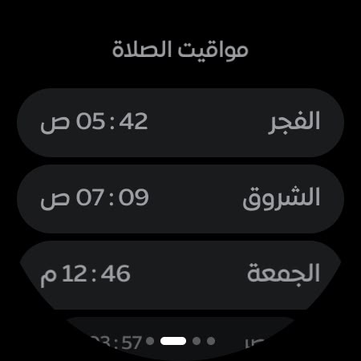
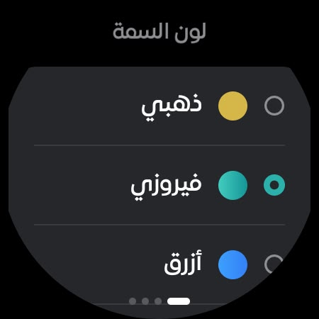
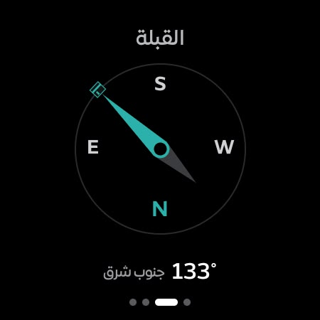

  
  <h1>Wathkkir (وذكّر)</h1>
  
<b>An app that reminds you of prayer times and dhikr through your day and your night.</b>

  
Accurate prayer times for your location, per-prayer adhan and iqama alerts, a Qibla compass, a Hijri date converter, and an azkar library with statistics that track your daily commitment — in a modern One UI-inspired design.

  

    
    
    
  

  
<b><a href="README.md">🇪🇬 النسخة العربية</a></b>

---

## 📑 Contents

- [Overview](#-overview)
- [Key features](#-key-features)
- [Latest additions](#-latest-additions)
- [Gallery](#-gallery)
- [Watch app](#-watch-app)
- [Supported languages](#-supported-languages)
- [Download](#-download)

---

## 🌙 Overview

Wathkkir is an open-source Android app that brings the everyday tools a Muslim needs into one place: astronomically accurate prayer times, fully customizable per-prayer alerts, morning and evening azkar with Hisn al-Muslim, a digital tasbeeh counter, and a Qibla compass — all with full right-to-left support and an interface translated into eleven languages.

## ✨ Key features

| Area | Features |
|---|---|
| 🕌 **Prayer times** | Automatic location via GPS or manual country/city selection, eight certified calculation methods (Egyptian General Authority, Umm al-Qura, Muslim World League, ISNA, University of Karachi, Kuwait, Qatar, Dubai), Asr juristic choice (Shafi'i or Hanafi), high-latitude rules, and manual per-prayer minute adjustments plus a Hijri date offset. |
| 🔔 **Prayer alerts** | An independent bell for each of the six prayer rows (including Shuruq), delivered as notifications, one-minute timing resolution (at adhan time or any number of minutes before, typed or dragged), **iqama reminder notifications** with per-prayer delays (Fajr 25 min, Dhuhr/Asr/Isha 20 min, Maghrib 10 min), **automatic Do-Not-Disturb** between adhan and iqama, and shared settings for notification sound and vibration. |
| 🧭 **Qibla compass** | An elegant dial that follows the system light/dark theme: a smoothly rotating tick ring with degree labels every 30°, a large heading readout with the direction name, a Kaaba marker at the Qibla bearing that turns green with a haptic tick within 3°, magnetic-declination correction to true north based on your location, and a calibration prompt when sensor accuracy drops. |
| 🕰️ **Optional times** | Optional prayer-screen rows: Imsak (10 minutes before Fajr), Duha, Midnight, and Qiyam (start of the last third of the night) — enabled from Settings as needed. |
| 📅 **Date converter** | One box with a One UI direction switch (Gregorian to Hijri or Hijri to Gregorian), a month list that follows the direction, and a centered "Today" button. Umm al-Qura calendar, weekday shown. |
| 📿 **Azkar & Hisn al-Muslim** | The complete Hisn al-Muslim library in chapters, custom azkar organized with colored tags, favorites, timed reminders, and preloaded prophetic duas. |
| 📊 **Statistics** | Daily commitment tracking: azkar read today, this week, and this month, plus a day-streak counter. |
| 🔢 **Tasbeeh** | A digital counter that keeps your progress even after the app is closed. |
| 📱 **Lock-screen widgets** | Fully customizable widgets (colors, background, text) showing prayer times on the lock screen. |
| 🎨 **Personalization** | Eleven UI languages with full RTL and LTR support, light/dark/system themes, and multiple Arabic fonts (Cairo, Naskh, Amiri, Ruqaa). |

<b>🔔 More about the alert system</b>

- Alerts arrive precisely on time and are automatically rescheduled after the device reboots.
- Each prayer has its own settings sheet via a long-press on its bell: timing, iqama reminder, and automatic DND.
- If the Do-Not-Disturb policy permission is missing, the app routes you to the system permission screen instead of silently pretending the feature works.

## 🆕 Latest additions

- **Fajr full-screen alarm** with its own settings page: tone or audio file, volume, vibration, ring before and/or after the adhan, ring duration, snooze length, test button.
- **One UI style menus and dialogs** everywhere, with Apply and Cancel on pickers. They follow the font size you choose.
- **Font size**: a 9-step slider in Settings > Appearance.
- **Hisn Al-Muslim**: search, "done reading" button, notes, counter colours, default favorites, add to my adhkar.
- **Per-prayer tone and vibration**, plus touch feedback only on controls that change state, following the haptics setting.
- **Widgets**: live previews in the picker on Android 15+.
- New onboarding, new icon, and the name Wathkkir (وذكّر) in every language.
- **Date converter redesigned**: one box, a One UI direction switch, and a "Today" button.
- **Time wheels**: the selected value sits inside the selection band, and AM/PM is a plain two-item wheel with no looping.
- **Page titles**: the gap above each title now matches the gap below it.

## 📸 Gallery

  <table>
    <tr><td align="center"> Prayer screen</td><td align="center"> Fajr alarm</td><td align="center"> Hisn Al-Muslim</td></tr>
    <tr><td align="center"> Reminders</td><td align="center"> Calendar</td><td align="center"> Qibla</td></tr>
    <tr><td align="center"> One UI style menus</td><td align="center"> Dialogs</td><td align="center"> Onboarding: language</td></tr>
    <tr><td align="center"> Calculation method</td><td align="center"> Enable alerts</td><td align="center"> Time wheel</td></tr>
    <tr><td align="center"> Gregorian to Hijri</td><td align="center"> Hijri to Gregorian</td></tr>
  </table>

### 📲 Lock Screen Widgets (For Samsung OneUI 7 and above)

  <table>
    <tr><td align="center"> Lock screen</td><td align="center"> Lock widget picker</td><td align="center"> Lock widgets</td><td align="center"> Lock widgets</td></tr>
    <tr><td align="center"> Home widgets</td><td align="center"> Home widget picker</td><td align="center"> Widget settings</td></tr>
  </table>

## ⌚ Watch app

The watch app is a separate download and runs on Wear OS 3 and newer. Its features:

- **Prayer times on your wrist**: the next prayer with its remaining time, both Hijri and Gregorian dates, and the full day list.
- **A Tile with a progress arc** showing the run-up to the next prayer, plus an iqama countdown after the adhan, with a preview in the tile picker.
- **Watch-face complications**: a next-prayer countdown with a progress ring, next prayer time, Hijri date, Gregorian date, or both dates together.
- **Adhan alert on the watch** with a choice of alert style: a regular notification or a full-screen notification.
- **Qibla compass** on the watch.
- **One UI style settings** organized in sections: Appearance (patterned backgrounds, theme colours, font style, and font size), Notifications, Language & location (sync with the phone or choose manually), and an "About this app" section showing the version.

  <table>
    <tr><td align="center"> Watch tile</td><td align="center"> Main screen</td><td align="center"> Countdown complication</td></tr>
    <tr><td align="center"> Friday prayer times</td><td align="center"> Theme colors</td><td align="center"> Qibla compass</td></tr>
  </table>

## 🌍 Supported languages

العربية · English · Français · Deutsch · Español · Italiano · Türkçe · اردو · Indonesia · Русский · Português

## 📥 Download

- **[Latest release](https://github.com/MohamedElnaggar00/Wathkkir/releases/latest)**: the phone app and the watch app.
- All versions: [Releases page](https://github.com/MohamedElnaggar00/Wathkkir/releases).

---

   
  <b><a href="https://instinct.com">brought to you by Instinct</a></b>
  
Mohamed Elnaggar

  
<i>Please keep us in your prayers.</i>

