

  
  <h1>وذكّر Wathkkir</h1>
  
<b>تطبيق يذكّر المستخدم بمواقيت الصلاة والذكر في يومه وليلته</b>

  
مواقيت دقيقة بحسب موقع المستخدم، تنبيهات أذان وإقامة لكل صلاة، بوصلة قبلة، محوّل تاريخ هجري، ومكتبة أذكار مع إحصائيات تتابع الالتزام اليومي — بواجهة عصرية مستوحاة من One UI.

  

    
    
    
  

  
<b><a href="README.en.md">🇬🇧 English version</a></b>

---

## 📑 المحتويات

- [نظرة عامة](#-نظرة-عامة)
- [الميزات الرئيسية](#-الميزات-الرئيسية)
- [أحدث الإضافات](#-أحدث-الإضافات)
- [معرض الصور](#-معرض-الصور)
- [تطبيق الساعة](#-تطبيق-الساعة)
- [اللغات المدعومة](#-اللغات-المدعومة)
- [التحميل](#-التحميل)

---

## 🌙 نظرة عامة

«وذكّر» تطبيق أندرويد مفتوح المصدر يجمع بين أدوات المسلم اليومية في مكان واحد: مواقيت الصلاة بدقة حسابية عالية، تنبيهات قابلة للتخصيص لكل صلاة على حدة، أذكار الصباح والمساء وحصن المسلم، مسبحة إلكترونية، وبوصلة قبلة — كل ذلك بتصميم عربي أصيل يدعم الكتابة من اليمين إلى اليسار بشكل كامل، وبإحدى عشرة لغة للواجهة.

## ✨ الميزات الرئيسية

| القسم | الميزات |
|---|---|
| 🕌 **مواقيت الصلاة** | تحديد الموقع تلقائيًا عبر GPS أو يدويًا باختيار الدولة والمدينة، ثماني طرق حساب معتمدة (الهيئة المصرية العامة للمساحة، أم القرى، رابطة العالم الإسلامي، أمريكا الشمالية ISNA، جامعة كراتشي، الكويت، قطر، دبي)، اختيار المذهب الفقهي لحساب العصر (شافعي أو حنفي)، قواعد خطوط العرض العالية، وتعديل يدوي بالدقائق لكل صلاة على حدة مع تعديل التاريخ الهجري. |
| 🔔 **تنبيهات الصلاة** | جرس مستقل لكل صلاة من الصلوات الست (بما فيها الشروق) يصل إلى المستخدم كإشعار، توقيت مرن بدقة دقيقة واحدة (عند الأذان أو قبله بعدد من الدقائق يُكتب أو يُختار بالسحب)، **إشعار تذكير الإقامة** بفواصل مضبوطة لكل صلاة (الفجر ٢٥ دقيقة، الظهر والعصر والعشاء ٢٠ دقيقة، المغرب ١٠ دقائق)، **وضع عدم الإزعاج التلقائي** بين الأذان والإقامة، وإعدادات مشتركة لنغمة الإشعار والاهتزاز. |
| 🧭 **اتجاه القبلة** | بوصلة أنيقة تتبع مظهر النظام فاتحًا أو داكنًا: قرص مدرّج بعلامات دقيقة وأرقام كل ٣٠ درجة يدور بسلاسة مع اتجاه الهاتف، أسماء الاتجاهات بالعربية (شمال/شرق/جنوب/غرب)، قراءة رقمية كبيرة للدرجة واسم الاتجاه، علامة كعبة مميزة عند زاوية القبلة تتحول إلى الأخضر مع اهتزاز تأكيدي عند الانحراف أقل من ٣ درجات، تصحيح الانحراف المغناطيسي بحسب الموقع (الشمال الحقيقي)، وتنبيه لمعايرة المستشعر عند ضعف الدقة. |
| 🕰️ **مواقيت إضافية** | صفوف اختيارية في شاشة الصلاة: الإمساك (قبل الفجر بعشر دقائق)، الضحى، منتصف الليل، وقيام الليل (بداية الثلث الأخير) — تُفعَّل من الإعدادات بحسب الحاجة. |
| 📅 **محوّل التاريخ** | صندوق واحد بمفتاح بأسلوب One UI للتبديل بين الاتجاهين (ميلادي إلى هجري أو هجري إلى ميلادي)، وقائمة الأشهر تتبع الاتجاه، وزر «اليوم» في الوسط، وفق تقويم أم القرى مع عرض اليوم الأسبوعي. |
| 📿 **الأذكار وحصن المسلم** | مكتبة أذكار كاملة من حصن المسلم مرتبة في فصول، إضافة أذكار خاصة وتنظيمها بتصنيفات ملوّنة، أذكار مفضلة، تذكيرات بأوقات مخصصة، وأدعية نبوية مضافة مسبقًا. |
| 📊 **الإحصائيات** | متابعة الالتزام اليومي: عدد الأذكار المقروءة اليوم وهذا الأسبوع وهذا الشهر، وسلسلة الأيام المتتالية. |
| 🔢 **المسبحة** | عدّاد تسبيح يحفظ التقدّم حتى بعد إغلاق التطبيق. |
| 📱 **ودجت شاشة القفل** | ودجت قابلة للتخصيص بالكامل (الألوان، الخلفية، النص) تعرض المواقيت على شاشة القفل. |
| 🎨 **التخصيص** | إحدى عشرة لغة للواجهة مع دعم كامل للاتجاهين RTL وLTR، وضع فاتح وداكن وتلقائي، وخطوط عربية متعددة (القاهرة، النسخ، الأميري، الرقعة). |

<b>🔔 تفاصيل إضافية عن نظام التنبيهات</b>

- تصل التنبيهات في وقتها بدقة، وتُعاد جدولتها تلقائيًا بعد إعادة تشغيل الجهاز.
- لكل صلاة نافذة إعداد مستقلة بالضغط المطوّل على جرسها: التوقيت بدقة دقيقة واحدة، إشعار الإقامة، وعدم الإزعاج التلقائي.
- عند عدم منح إذن الوصول إلى وضع عدم الإزعاج، يوجّه التطبيق المستخدمَ إلى شاشة الإذن في النظام بدلًا من تفعيل شكلي لا يعمل.

## 🆕 أحدث الإضافات

- **منبه صلاة الفجر** بشاشة كاملة وصفحة إعدادات خاصة: نغمة أو ملف صوتي، مستوى الصوت، الاهتزاز، الرنين قبل الأذان و/أو بعده، مدة الرنين، مدة الغفوة، وزر تجربة.
- **قوائم ونوافذ بأسلوب One UI** في كل التطبيق، وأزرار «تطبيق» و«إلغاء» في المنتقيات، وهي تتبع حجم الخط الذي يختاره المستخدم.
- **حجم الخط** بمنزلق من تسع درجات في الإعدادات ثم المظهر.
- **حصن المسلم**: بحث، زر «تمت القراءة»، ملاحظات، ألوان للعدّاد، مفضلة افتراضية، وزر إضافة إلى أذكاري.
- **نغمة واهتزاز مستقلان لكل صلاة**، مع اهتزاز لمس على عناصر التحكم التي تغيّر حالة فقط، ويتبع إعداد الاهتزاز.
- **ودجتات**: معاينة حية في المنتقي على أندرويد 15 فأعلى.
- بداية استخدام جديدة، وأيقونة جديدة، والاسم وذكّر في كل اللغات.
- **محوّل تاريخ بتصميم جديد**: صندوق واحد ومفتاح اتجاه بأسلوب One UI وزر «اليوم».
- **عجلات الوقت**: القيمة المختارة داخل إطار الاختيار، وعجلة ص/م من عنصرين فقط بلا تكرار.
- **عناوين الصفحات**: المسافة فوق العنوان مثل المسافة تحته في كل الصفحات.

## 📸 معرض الصور

  <table>
    <tr><td align="center">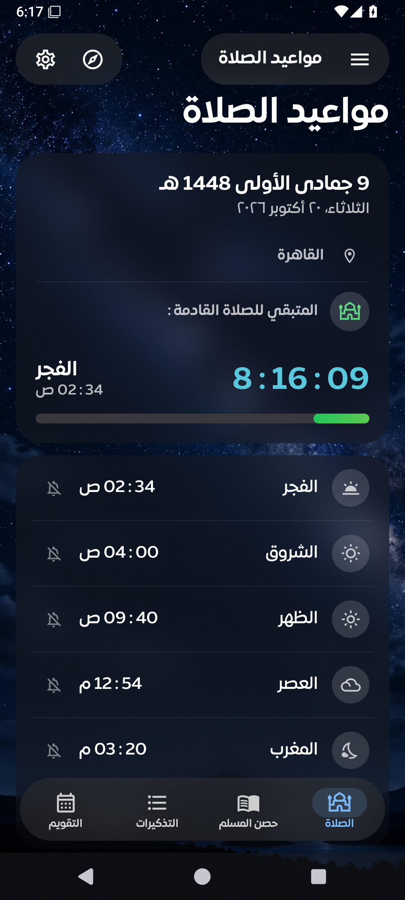 شاشة الصلاة</td><td align="center">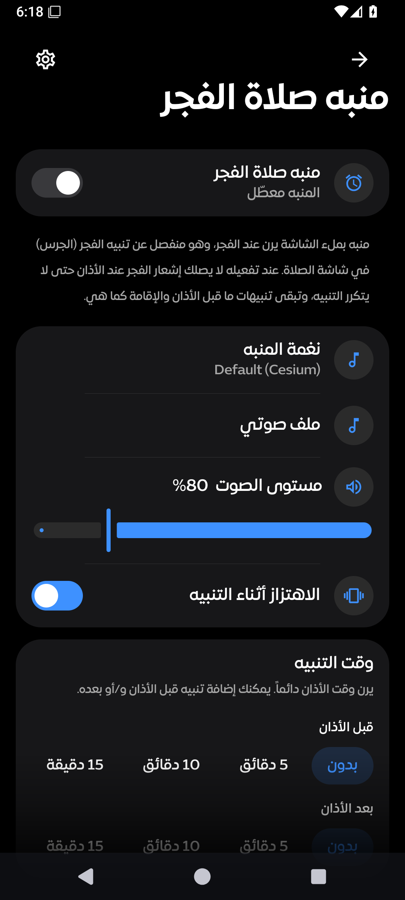 منبه صلاة الفجر</td><td align="center">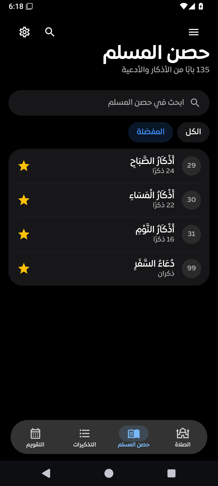 حصن المسلم</td></tr>
    <tr><td align="center">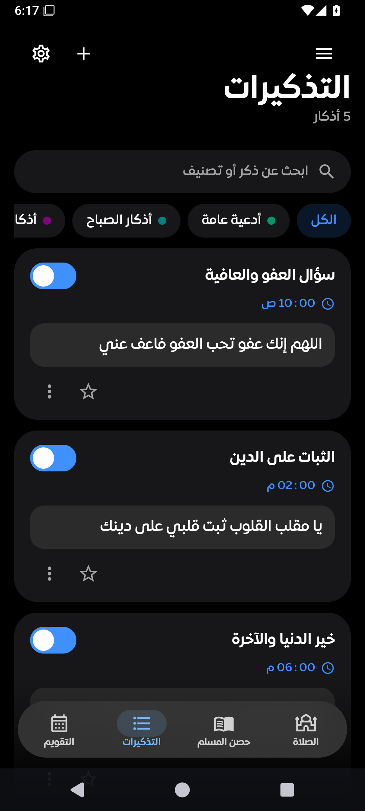 التذكيرات</td><td align="center">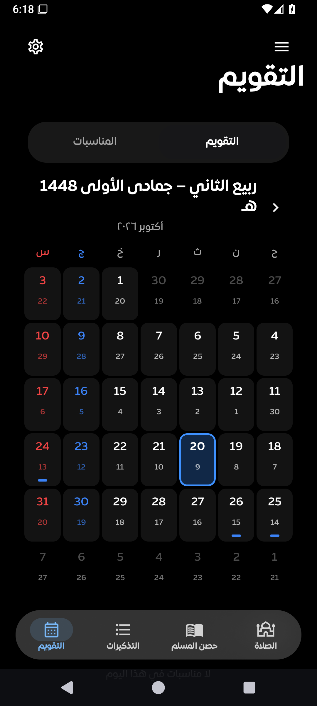 التقويم</td><td align="center">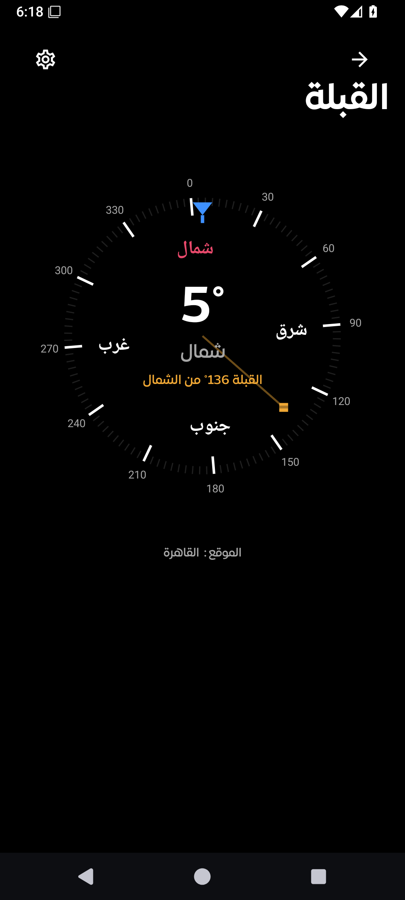 القبلة</td></tr>
    <tr><td align="center">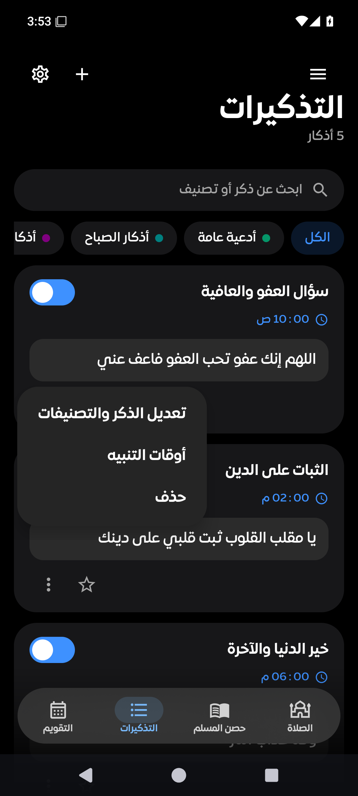 قوائم بأسلوب One UI</td><td align="center">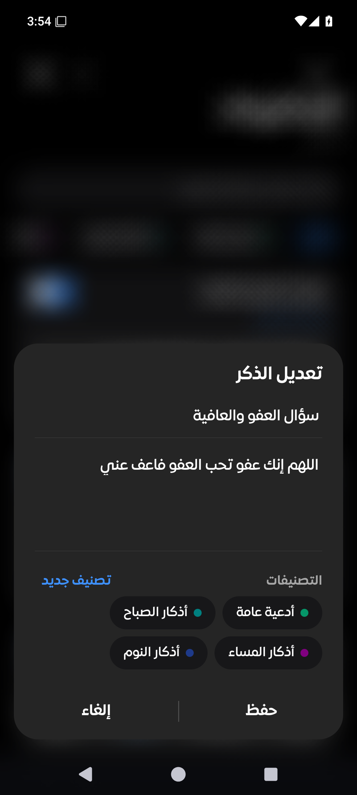 نوافذ الحوار</td><td align="center">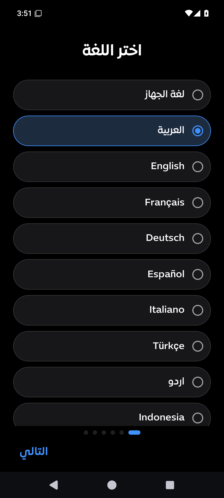 بداية الاستخدام: اللغة</td></tr>
    <tr><td align="center">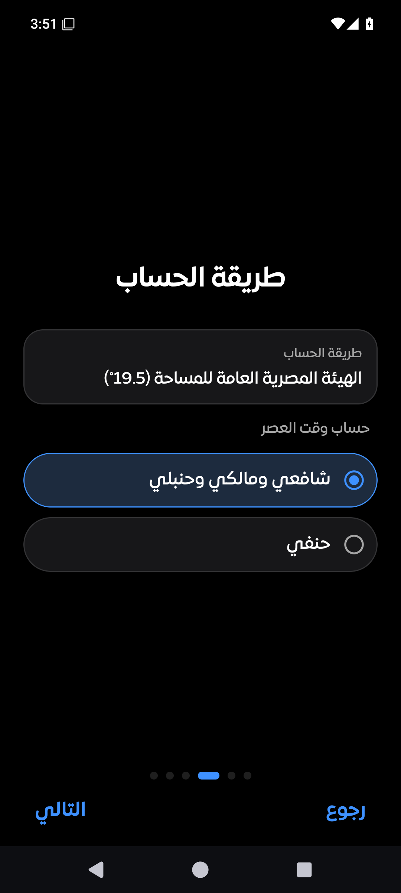 طريقة الحساب</td><td align="center">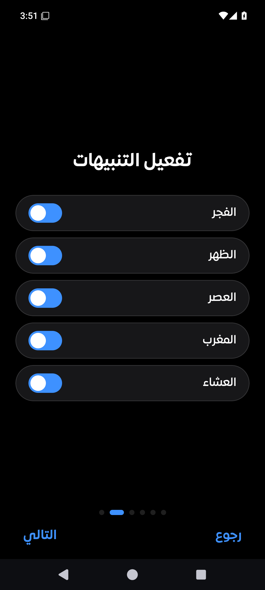 تفعيل التنبيهات</td><td align="center">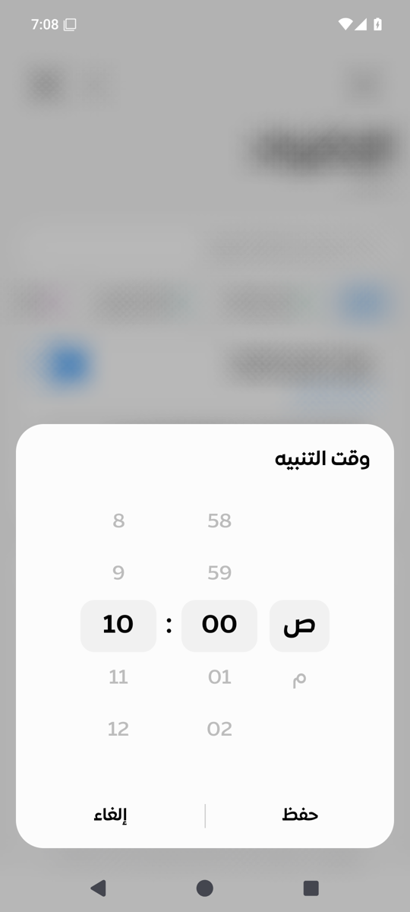 عجلة الوقت</td></tr>
    <tr><td align="center">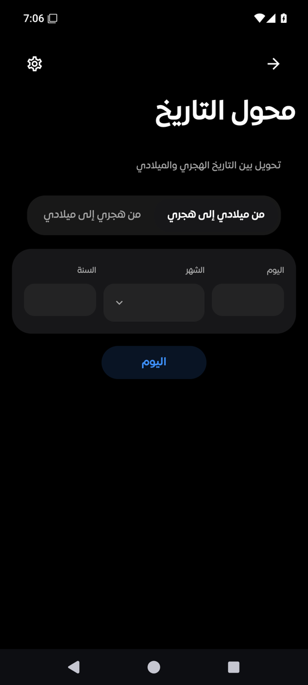 ميلادي إلى هجري</td><td align="center">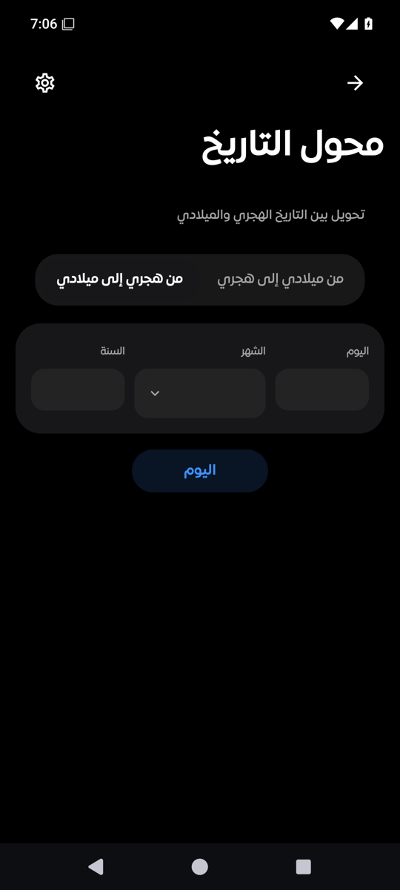 هجري إلى ميلادي</td></tr>
  </table>

### 📲 من جهاز حقيقي

<i>لقطات من هاتف حقيقي: شاشة القفل والشاشة الرئيسية وإعدادات الودجت.</i>

  <table>
    <tr><td align="center">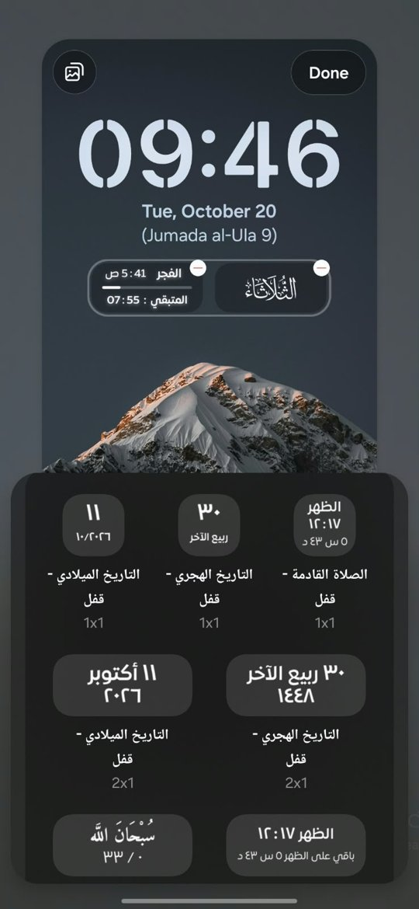 شاشة القفل</td><td align="center">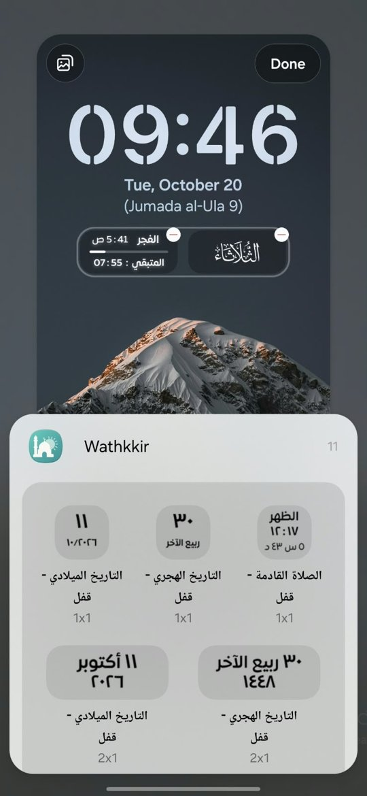 منتقي ودجت القفل</td><td align="center">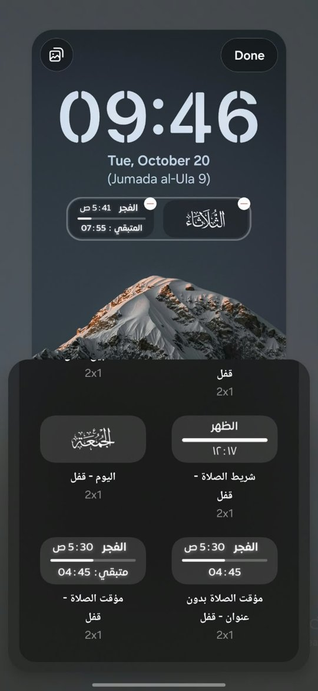 ودجت القفل</td><td align="center">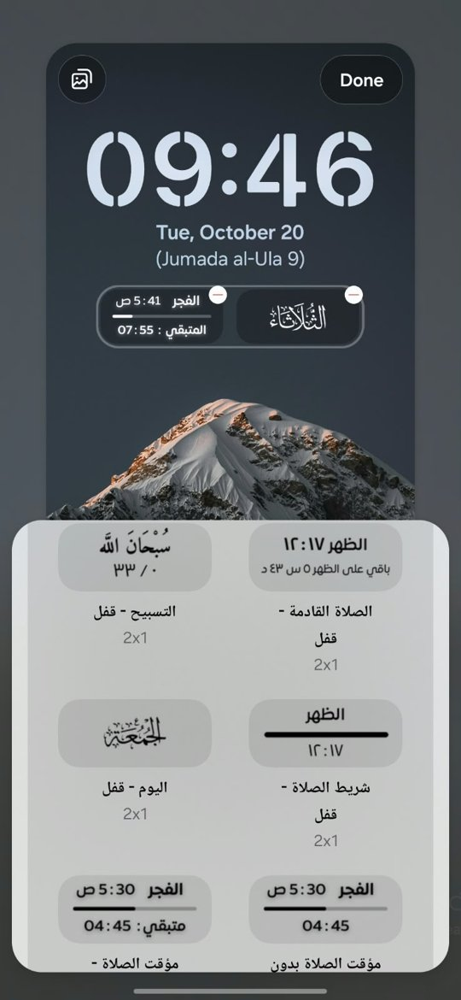 ودجت القفل</td></tr>
    <tr><td align="center">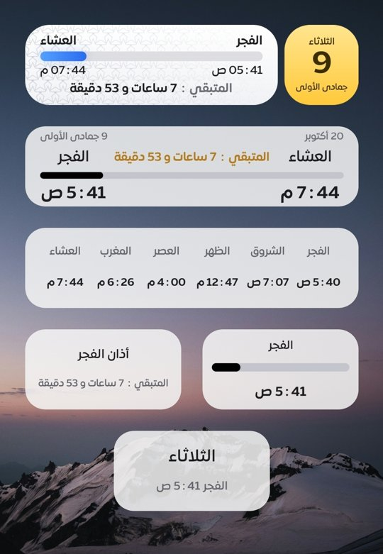 ودجت الرئيسية</td><td align="center">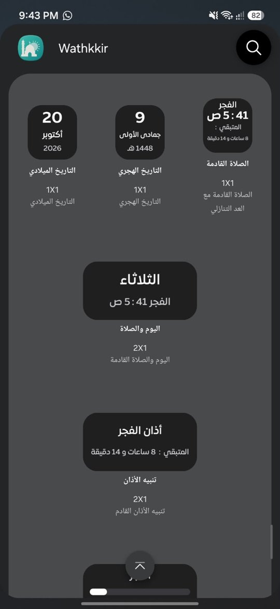 منتقي ودجت الرئيسية</td><td align="center">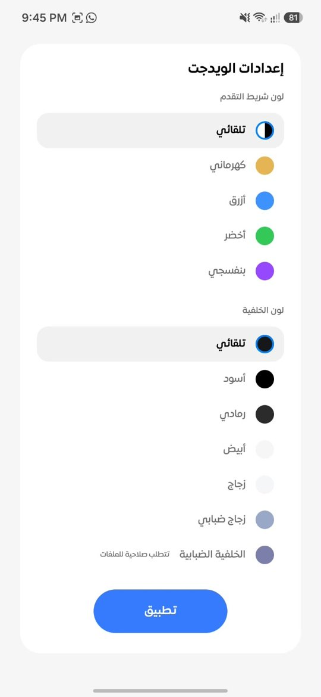 إعدادات الودجت</td></tr>
  </table>

## ⌚ تطبيق الساعة

يُنزَّل تطبيق الساعة كملف منفصل ويعمل على ساعات Wear OS 3 فأحدث. ميزاته:

- **مواقيت الصلاة على المعصم**: الصلاة القادمة مع الوقت المتبقي، التاريخ الهجري والميلادي، وقائمة مواقيت اليوم كاملة.
- **بلاطة (Tile) بقوس تقدّم** يوضح مجرى الوقت حتى الصلاة القادمة، وعدّاد للإقامة بعد الأذان، مع معاينة في منتقي البلاطات.
- **قطع (Complications) لوجه الساعة**: عدّ تنازلي للصلاة القادمة بحلقة تقدّم، وقت الصلاة القادمة، التاريخ الهجري، التاريخ الميلادي، أو التاريخان معًا.
- **تنبيه الأذان على الساعة** مع اختيار أسلوب التنبيه: إشعار عادي أو إشعار بملء الشاشة.
- **بوصلة قبلة** على الساعة.
- **إعدادات بأسلوب One UI** مرتبة في أقسام: المظهر (خلفيات مزخرفة، ألوان السمات، نوع الخط، وحجم الخط)، الإشعارات، اللغة والموقع (مزامنة مع الهاتف أو اختيار يدوي)، وقسم «معلومات حول التطبيق» الذي يعرض رقم الإصدار.

  <table>
    <tr><td align="center">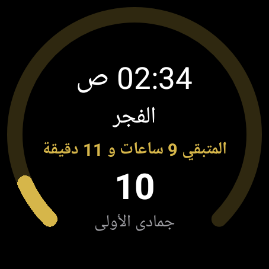 بلاطة الساعة</td><td align="center">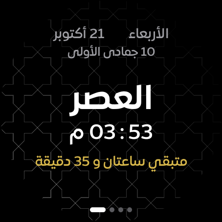 الشاشة الرئيسية</td><td align="center">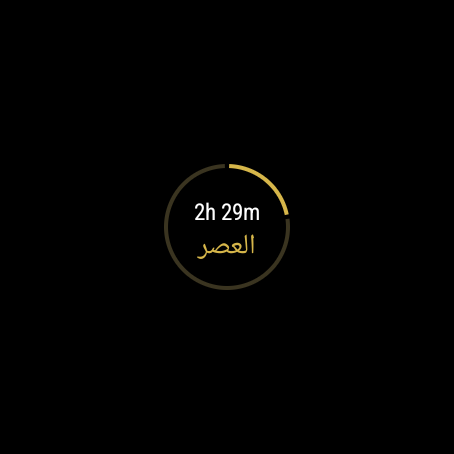 قطعة العد التنازلي</td></tr>
  </table>

## 🌍 اللغات المدعومة

العربية · English · Français · Deutsch · Español · Italiano · Türkçe · اردو · Indonesia · Русский · Português

## 📥 التحميل

- **[أحدث إصدار](https://github.com/MohamedElnaggar00/Wathkkir/releases/latest)**: ملف الهاتف وملف الساعة.
- كل الإصدارات: [صفحة الإصدارات](https://github.com/MohamedElnaggar00/Wathkkir/releases).

---

   
  <b><a href="https://instinct.com">brought to you by Instinct</a></b>
  
محمد النجار

  
<i>لا تنسونا من صالح دعائكم.</i>

